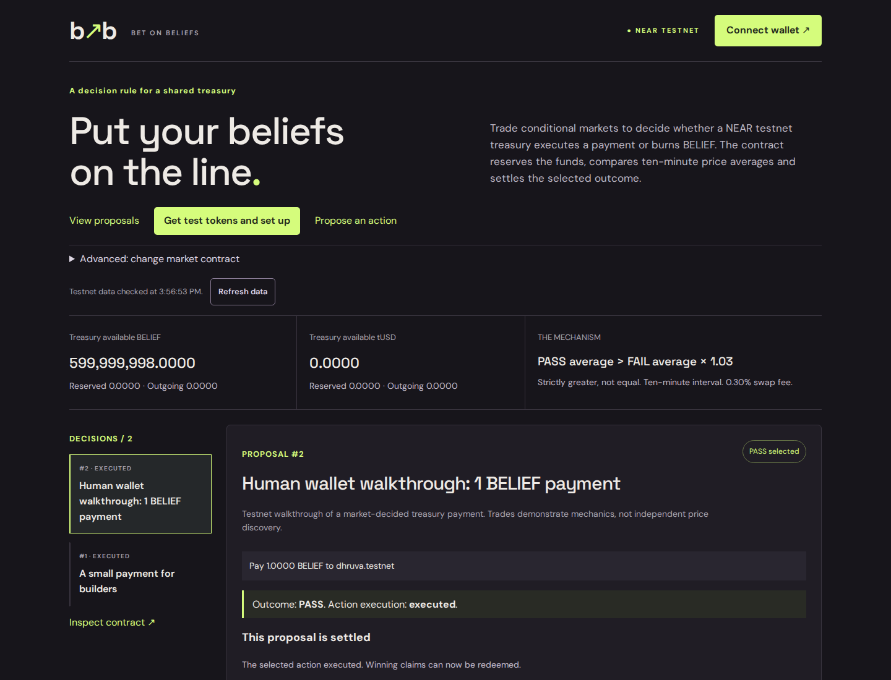
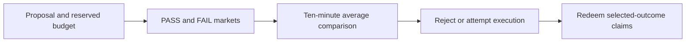

# Bet on Beliefs

A memecoin whose treasury moves only when a market predicts the move will raise the coin's price. Futarchy, live on NEAR testnet.

The rule compares BELIEF prices in conditional PASS and FAIL markets. It is not a guarantee of future price appreciation or public benefit.

[Live app](https://dhruva-0206.github.io/bet-on-beliefs/) · Demo video: &lt;X link&gt; · [Design](DESIGN.md) · [Verification](docs/EVIDENCE.md)



## Executive summary for judges

- Problem: token voting and discretionary control can leave a gap between a treasury decision, its expected effect and who bears the risk.
- What I built: a BELIEF treasury with conditional PASS/FAIL markets for payments and a 1% treasury burn.
- How NEAR fits in: NEAR testnet contracts hold the treasury and execute market-approved actions, using NEP-141 tokens and Meteor wallet signing.
- Proof: two payment proposals executed by market decision, including one I signed end to end through the public site. [Verified receipts](docs/EVIDENCE.md#receipt-links).
- Honest limits: testnet tokens, thin markets, retained upgrade keys and no independent audit.

## The problem

Token voting measures voting power, but a vote does not necessarily reveal a holder's confidence in a proposal's effect. Discretionary treasury control can also leave spending decisions dependent on a small group. I wanted to test a different rule: let participants take conditional positions, then use the market comparison to decide whether a treasury action goes ahead.

## How it works

1. Propose a payment or a burn of 1% of available treasury BELIEF, supplying liquidity from your own vault.
2. Two conditional markets open: the world where the action passes and the world where it fails.
3. Participants trade conditional BELIEF and tUSD in either world. Splitting creates both claims; trading one side leaves the opposite-side claim with its owner.
4. After ten minutes, the contract compares average prices. PASS must be strictly greater than FAIL × 1.03. Equality rejects the action.
5. The contract rejects the action or attempts execution of the selected action. Selected-outcome claims can then be redeemed one-for-one for the underlying token.



The outcome and execution status are separate. A failed payment restores the action budget without changing the selected outcome. Holding a claim in the selected world does not mean a trader made a profit.

## Why this matters

A treasury rule should make its decision and spending traceable, while giving accurate beliefs a chance to earn trading returns. This experiment tests that connection; BELIEF price is not a measure of public benefit. [MetaDAO on Solana](https://metadao.com/docs) inspired the futarchy mechanism.

## Try it in 5 minutes

Five minutes covers browsing and setup. A full proposal takes at least ten minutes after creation.

1. Open the [app](https://dhruva-0206.github.io/bet-on-beliefs/) → see two executed payment proposals and the real testnet treasury. Executed proposals are available for inspection, not further trading.
2. Connect Meteor with a separate funded testnet account → see your account and wallet balances. The app never needs your recovery phrase or private key.
3. Select “Get test tokens and set up”, then “Get 100 BELIEF” or “Get 100 tUSD” → receive test tokens from finite reserves. Each call attaches 0.01 testnet NEAR for token registration plus gas; excess storage deposits are refunded.
4. Register your market account (0.01 NEAR retained), then deposit an amount → see tokens move from your wallet into your vault. The treasury is a separate balance; donations cannot be withdrawn as vault funds.
5. Inspect the completed examples or deliberately create a new proposal → proposal creation uses both vault stakes and retains 0.1 NEAR. For an open proposal, additional participants register claims (0.01 NEAR retained), then split/trade with a minimum output. The proposer is registered automatically.

After the interval, finalization and redemption each retain 0.01 testnet NEAR plus gas. Inspect final receipts and refreshed balances after every action.

<details>
<summary>Registration, deposits and other fees</summary>

Token storage registration follows NEP-145 and is separate from market and per-proposal claim registration. Native testnet NEAR pays storage and gas; the BELIEF/tUSD faucets do not provide it. Wallet-to-vault deposits use `ft_transfer_call` with message `stake` and 1 yoctoNEAR attached. Invalid inflows return unused tokens rather than credit the vault.

Finalization, withdrawal, merge and redemption each retain 0.01 NEAR where required by the contract. Proposal creation retains 0.1 NEAR; excess market-operation deposits are also retained. Token-storage excess is refunded. Swaps charge 0.30%, which stays in pool reserves. A payment recipient must already be registered in the selected token. [Wallet instructions](docs/FRONTEND.md) cover exact controls and recovery.

</details>

## Proof it works

| What was checked | Verified result | Evidence |
| --- | --- | --- |
| Contract unit tests | 35 passing tests for tokens, arithmetic, lifecycle and oracle fixtures | [Scope and commands](docs/EVIDENCE.md#automated-checks) |
| Real-Wasm sandbox | One four-proposal scenario covers execution, failures, backing and authorization | [Accounting](docs/ACCOUNTING.md) |
| Scripted testnet payment | Proposal 0 (UI #1) selected PASS, paid 1 BELIEF and completed trader redemptions | [Receipts](deployments/README.md#actual-lifecycle-evidence) |
| My public-site Meteor lifecycle | Proposal 1 (UI #2), deposits, PASS trade, payment and both redemptions verified FINAL | [Receipts](docs/EVIDENCE.md#receipt-links) |
| Final accounting | Wallet 201 BELIEF / 100 tUSD; vaults, winning claims and proposal collateral zero at block 277648609 | [Fixed-block snapshot](deployments/human-lifecycle-final-accounting.json) |
| Frontend regression tests | 8 unit/compatibility, 14 production, 14 development and 4 Pages-path checks | [Scope](docs/EVIDENCE.md) |

Browser regressions use synthetic signing boundaries. Human signatures, scripted testnet transactions and sandbox cases are separate evidence. Snapshots retain the state at their recorded blocks. [Detailed evidence](docs/EVIDENCE.md) includes dependency review, layout checks and original receipts.

## Limitations

- Testnet tokens have no promised value. Faucets redistribute finite reserves and can be drained by repeated calls.
- Thin markets and sustained or sufficiently extreme short manipulation can change the outcome.
- Token price is not public welfare. Conditional market prices do not establish causation or guarantee future appreciation.
- Full-access keys remain on all three contracts, so code can be replaced. The contracts are not independently audited.
- Only one proposal may be active or executing, and each proposal has a sole proposer liquidity provider.
- The UI does not expose numerical decision averages. Accessibility checks cover specific cases, not full WCAG compliance.
- Dependency review records remaining low elliptic-chain findings and build warnings. [Details](docs/DEPENDENCY_REVIEW.md).

## How I built this

- I chose the idea and scope for Bet on Beliefs.
- I investigated the public hackathon directory as part of that choice, without treating the search as proof of uniqueness.
- I chose testnet, one active proposal, and payments or burns.
- I set the contract freeze and directed implementation in phases.
- I insisted that claims stay tied to receipts, tests and stated limits.
- I personally signed the recorded public-site Meteor lifecycle.
- I orchestrated Codex implementation, debugging and review.

## Independent project disclosure

Also by me: [Builders First](https://github.com/Dhruva-0206/builders-first), an independent NEAR investment thesis.

## Architecture, reproduction, credits and license

Three Rust contracts implement BELIEF, tUSD and the treasury market. The Vite/React/TypeScript frontend reads testnet RPC and connects Meteor through NEAR Wallet Selector. There are no AI traders, cron jobs or cross-chain integrations.

```sh
bash scripts/setup-dev.sh
npm ci --prefix web
npm run test --prefix web
npm run build --prefix web
npm run preview --prefix web
# Browser installation and regression checks:
cd web
npx playwright install --with-deps chromium
npm run test:browser
BOB_DEV_BROWSER=1 npm run test:browser
cd ..
VITE_MARKET_CONTRACT=bob-dhruva-market.testnet npm run build:pages --prefix web
npm run test:pages --prefix web
```

Contract checks: `cargo test --workspace --exclude integration-tests --locked`, `bash scripts/build-contracts.sh`, then `cargo test -p integration-tests --test lifecycle --locked -- --nocapture`.

Pinned tools and libraries include Rust 1.95.0, Node 24.22.2, npm 11.19.1, NEAR SDK/standards 5.30.1, uint 0.10.0, near-workspaces 0.24.0 and cargo-near 0.21.0. Frontend library versions and scoped Meteor compatibility overrides are recorded in [package.json](web/package.json) and [package-lock.json](web/package-lock.json). [Linux development](docs/DEVELOPMENT.md), [mechanism design](DESIGN.md), [oracle](docs/ORACLE.md), [accounting](docs/ACCOUNTING.md), [hosting](docs/HOSTING.md) and [interface guidance](docs/FRONTEND.md#interface-design) explain reproduction and design choices. Contract accounts and current artifact hashes are in the [testnet manifest](deployments/testnet-bob-dhruva.json) and [BUILD_HASHES](docs/BUILD_HASHES.json).

Created and led by Dhruva Somen Chakrabarty. Code written with AI coding assistance (Codex) under my direction; design decisions and review are mine.

[MIT license](LICENSE). Copyright (c) 2026 DHRUVA SOMEN CHAKRABARTY.

Built for NEAR HACKATHON, November 2026. Tracks: Memecoins With Mechanics; Social Money.
